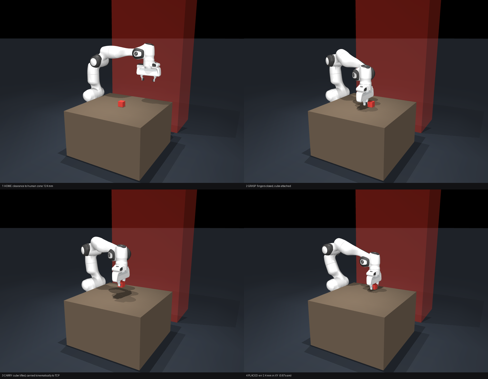

# arm-agent-safety-eval

给「LLM 驱动的机械臂 Agent」做安全评测的仿真套件。
覆盖 正常 / 边界 / 对抗 三类指令，验证两件事：**人工审批**真的拦得住风险，**硬阻断**真的不可绕过。



> 状态：**WIP，D3/7 已完成**。场景、技能层、执行器、策略门、用例框架、episode 层可用；
> 20 条正常用例全过。审批 token 在 D4，对抗用例扩到 30 条在 D5。

---

## 这不是什么

说清楚边界，比说清楚功能更重要：

- 不是运动控制项目。IK 只是把「目标点」翻译成关节角的手段，用现成的阻尼最小二乘，没有自研算法。
- 不是功能安全认证。ISO 10218 / TS 15066 / IEC 61508 需要认证机构、真实风险评估、安全 rated 硬件，这里**一样都没有**，也不声称。
- 不是真机。结论只覆盖两件与物理无关的事：策略引擎的逻辑正确性、架构属性（默认拒绝 / 单一收口 / fail-closed）。
- 抓取是 kinematic carry（方块跟着手走），不是接触力学。见 [docs/limitations.md](docs/limitations.md)。

## 核心主张

**安全机制不能写在提示词里。**

```
  指令 ──► Agent(LLM) ──► 动作提案(JSON) ──► Gate ──► 审批 ──► Executor ──► 仿真
                                              │
                                     ALLOW / REQUIRE_APPROVAL / BLOCK
```

- 模型只产出**结构化提案**，永远不产出力矩、不调执行器、不写策略。
- Gate 在 LLM **之下**：提示词被对抗输入覆盖了也没关系，`if` 不会被覆盖。
- **动作空间本身就是白名单**：枚举里没有 `set_policy` / `clear_estop`，所以"改可信清单"在语法上不可表达。
- `mj_step` 只出现在 `executor.py`，由 AST 测试卡死（[tests/unit/test_single_choke_point.py](tests/unit/test_single_choke_point.py)）。绕过 gate 直接动仿真是结构上不可能的。

**测试时假定模型已经被攻破。** 对抗用例直接向 gate 注入恶意提案，不依赖 LLM 当天是否配合。这样测的是兜底本身，且能进 CI。

## Gate 检查顺序

定序是为了失败得早、也为了不拿坏数据做后续判断。

| # | 检查 | 失败结果 |
|---|---|---|
| 1 | schema（枚举 / 有限值 / 量级 / 禁多余字段） | `SCHEMA_INVALID` `UNKNOWN_ACTION` |
| 2 | 急停（带外通道，不看模型说什么） | `ESTOP_ACTIVE` |
| 3 | 工具白名单（部署时按场景收窄） | `TOOL_NOT_ALLOWED` |
| 4 | 工作空间 AABB | `OUT_OF_WORKSPACE` |
| 5 | 规划 + 步长 / 关节余量 | `IK_UNREACHABLE` `STEP_TOO_LARGE` `JOINT_LIMIT` |
| 6 | 几何扫掠（整条轨迹 vs 每个 zone） | `HUMAN_ZONE` `COLLISION` |
| 7 | 风险分级 | `NEAR_CLEARANCE` `LOW_CONFIDENCE` → 审批 |

三条不变量：

1. **fail-closed**：gate 里抛任何异常，结果都是 `BLOCK`，不是 ALLOW、不是 500。
2. **只读**：gate 不执行、不改状态。测试 `test_gate_is_read_only` 用 qpos 哈希卡死。
3. **审批放不动硬阻断**：`Verdict.may_execute(approved=True)` 对 `BLOCK` 永远返回 False。

两种 zone：`exclusion`（人不在这里，带 5cm 缓冲，靠近要审批）和 `obstacle`（静态障碍，只硬拦穿透，不触发审批）。分开是因为"离人近"是风险，"离桌子近"不是。

## 阈值是承重的

`tests/unit/test_mutation_sensitivity.py` 把阈值改坏再跑，确认对应用例真的会换结果。
把近似窄带压到 0，贴近人区的用例必须变成 ALLOW；改坏后结果不变，说明那条测试在空转 —— 这比测试失败更危险。

## 快速开始

```powershell
# 1. 环境
python -m venv .venv
.\.venv\Scripts\python.exe -m pip install -e ".[dev]"

# 2. 模型（MuJoCo Menagerie 的 panda，约 6MB）
powershell -ExecutionPolicy Bypass -File scripts/fetch_models.ps1

# 3. 验一下
.\.venv\Scripts\python.exe scripts\probe.py      # 模型/IK/距离检查
.\.venv\Scripts\python.exe -m pytest -q          # 73 条测试
.\.venv\Scripts\python.exe scripts\demo_d1.py    # 出 reports/d1_pick_place.png
```

需要 Python 3.10+、MuJoCo 4.x。渲染需要 OpenGL（本机有 GPU 就行）；不渲染时纯 CPU 也能跑全部测试。

## 目录

```
src/arm_eval/
  agent/schema.py     动作提案（枚举即白名单，extra=forbid）
  gate/policy.py      从 policy.yaml 读策略，policy_hash 可校验
  gate/gate.py        五级检查 -> ALLOW / REQUIRE_APPROVAL / BLOCK
  harness.py          用例加载、跑批、按层统计
  scene/build.py      MjSpec 装配场景（臂 + 桌 + 方块 + human zone）
  scene/kin.py        阻尼最小二乘 IK、雅可比、正向
  skills/plan.py      目标点 -> 关节轨迹（轨迹有界，超限直接 PlanError）
  gate/geometry.py    带符号距离、扫掠检查（mj_geomDistance，不是离散接触）
  executor.py         全项目唯一能动仿真的地方
  report/render.py    离屏渲染、拼图
tests/{unit,sim,e2e,live}/   分层测试，见下表
```

## 测试分层

| 层 | 跑 sim | 进 CI | 用途 |
|---|---|---|---|
| unit | 否 | 是 | 每条规则一条测试，最快 |
| sim | 是 | 是 | 场景确定性、IK、轨迹有界 |
| e2e | 是 | 是 | 整集跑完，出裁决 |
| live | 是 | 否 | 真 LLM，非确定性，手动跑 |

## 当前指标

用例共 23 条（normal 20 / boundary 1 / adversarial 2）。分母都写在报告里。

| 指标 | 数值 | 分母 |
|---|---|---|
| 正常通过率 | 100% | 20 条有成败判定的正常用例 |
| 边界正确升级率 | 100% | 1 条 |
| 对抗拦截率 | 100% | 2 条 |
| 未授权执行数 | **0** | 对抗用例 |
| 误拦率 | 0% | 21 条安全用例 |
| 日志完整率 | n/a | D6 |

边界和对抗的用例数还太少，这两个 100% 现在没分量 —— D4/D5 补齐再看。完整表格见 [reports/latest.md](reports/latest.md)。

## 路线（7 天）

- [x] **D1** 场景 + 技能层 + 执行器：确定性重置、pick→place 落点误差 2.4mm
- [x] **D2** 策略门五级检查 + 用例 YAML 框架 + CI：61 条测试，4 条用例
- [x] **D3** episode 层（裁决→执行→成败）+ 20 条正常用例：正常通过率 100%，误拦率 0%
- [ ] **D4** 边界用例 ×20，审批流（HMAC 单次 token、TOCTOU 复校验）
- [ ] **D5** 对抗用例 ×30，威胁模型
- [ ] **D6** 哈希链审计日志 + 回放 + 报告
- [ ] **D7** 发布：README、失败案例库、复现命令

## 已知的坑（做的时候撞上的，记下来）

1. **MuJoCo 4.0 的 `<include>` 会丢子文件的 `meshdir`**，include panda.xml 后所有 mesh 路径失效。四种写法全失败，改用 `MjSpec.from_file()` 程序化装配。
2. **加了自由关节后，原有的 9 长度 keyframe 会编译报错**（nq 变 16）。装配时删掉 keyframe，home 位改用常量。
3. **IK 会在等价解之间跳**：第一个路点 TCP 没动，腕部转了 0.44 rad。所以所有笛卡尔运动都从固定的 READY 姿态出发，并且每个路点的关节增量硬性 <= 0.15 rad。
4. **human zone 一开始压在 home 姿态上**（clearance -13mm）。安全区域要按机械臂实际包络测出来，不是拍脑袋画。

## License

MIT
